# clipper: turn podcasts and interviews into post-ready clips by just posting a link

[](LICENSE)
[](https://code.claude.com/docs/en/skills)
[](#requirements)

**Paste a podcast, interview, panel or X broadcast link (video). Get back a folder of clean, captioned, post-ready short clips, a Google Drive folder with public links, and a Google Doc your team can post from.**

clipper is an open-source [Claude Code](https://code.claude.com) skill (an Agent Skill) that does the whole clipping job end to end: download, transcribe, pick the moments, cut, QA, package, share. Transcription and cutting run on your Mac with MLX Whisper and ffmpeg, so there are no per-minute fees.

<p align="center">
  
</p>

## install

**Option 1: skills CLI** (works with Claude Code and other agents that read Agent Skills)

```bash
npx skills add RealAdii/clipper-skill
```

**Option 2: Claude Code plugin marketplace**

```
/plugin marketplace add RealAdii/clipper-skill
/plugin install clipper@clipper-skill
```

On Claude Code 2.1.275 or later this is one step: `/plugin install clipper --marketplace RealAdii/clipper-skill`

**Option 3: git clone**

```bash
git clone https://github.com/RealAdii/clipper-skill ~/clipper-skill
ln -s ~/clipper-skill/skills/clipper ~/.claude/skills/clipper
```

## use it

In Claude Code, just ask:

```
clip this https://www.youtube.com/watch?v=...
```

Other phrasings work too: "make clips from this interview", "turn this podcast into shorts", "clip it and put it on drive", or a path to a local video file. Claude runs the pipeline, shows you the plan, and hands back the folder, zip, Drive link and Doc link.

## what you get

```
~/Desktop/<episode-slug>/
  01_cold_open.mp4
  02_the_big_claim.mp4
  ...
  <episode-slug>_full_episode.mp4   trimmed full episode (optional)
  clips.txt                         every clip: source timestamps, length, caption
  transcript.txt                    timestamped transcript
~/Desktop/<episode-slug>.zip
Google Drive folder                 every video shared "anyone with the link"
Google Doc                          captions, timestamps and a link per clip
```

Each clip is one idea, 30 seconds to 2 minutes, starting on the first word of a complete thought and ending on the full stop of the answer. Typically 6 to 13 clips per hour of footage.

## how it works

| step | tool | what happens |
| --- | --- | --- |
| 1. fetch | `yt-dlp` | download from X, YouTube or anything yt-dlp reads, or link a local file |
| 2. transcribe | MLX Whisper `large-v3-turbo` | on-device, timestamped transcript |
| 3. plan | Claude | reads the whole transcript, picks the strongest moments, writes captions with verbatim quotes |
| 4. cut | `ffmpeg` | H.264 CRF 18, padded to word boundaries, short audio fades so cuts never click |
| 5. check | MLX Whisper | re-transcribes the first and last 5 s of every clip and builds a contact sheet; bad boundaries get fixed with word-level timing and re-cut |
| 6. package | Python | Desktop folder plus zip |
| 7. drive | Google Drive API via `gcloud` | resumable upload, public links (asks before the first upload) |
| 8. doc | Google Docs | shareable doc with captions, timestamps and links |

The full playbook Claude follows is in [skills/clipper/SKILL.md](skills/clipper/SKILL.md).

## why not an AI clipping SaaS?

- **No per-minute pricing.** Transcription and cutting run locally. You only use your existing Claude Code plan.
- **Local processing.** Transcription and cutting run on your machine; nothing is uploaded until the optional Drive step, which asks first.
- **Clean cuts.** Every boundary is checked by re-transcribing it, so clips never start mid-word or end on "and so...".
- **Real quotes.** Captions quote the transcript verbatim. Nothing is invented or "cleaned up".
- **Hand-off ready.** The Drive folder and Doc are built for a social or comms team to post from directly.
- **Hackable.** About 400 lines of plain Python and zsh. Change the caption style, clip length or output layout by editing a markdown file.

## requirements

- macOS on Apple Silicon (MLX Whisper needs it)
- [Claude Code](https://code.claude.com)
- `ffmpeg` and `yt-dlp`: `brew install ffmpeg yt-dlp`
- Python 3; `skills/clipper/scripts/setup.sh` builds a venv with `mlx-whisper` on first run (the model is about 1.6 GB)
- For the Drive and Doc steps only: `gcloud auth login --enable-gdrive-access`

## faq

**Is there a free, open-source alternative to Opus Clip or other AI clip makers?**
clipper is one. It is MIT licensed, runs the heavy work on your own Mac, and uses Claude for the editorial judgment of which moments are worth posting.

**Does it work on Windows, Linux or Intel Macs?**
Not yet. Transcription uses MLX, which is Apple Silicon only. Swapping in `faster-whisper` would make it cross-platform; PRs welcome.

**Can it clip an X (Twitter) live broadcast?**
Yes. Replays (`x.com/i/broadcasts/...`) work once the stream ends. For a stream that is still live, `skills/clipper/scripts/live/liveclip <url>` keeps a rolling 20 minute buffer and `skills/clipper/scripts/live/clip 60` grabs the last 60 seconds.

**Do I need Google Drive?**
No. Stop after the package step and you have the Desktop folder and zip. Drive and the Doc are for handing clips to a team.

**Does it make vertical 9:16 clips or burn in subtitles?**
Not today. Clips keep the source aspect ratio, and captions are written as post copy, not burned into the video.

**How long does it take?**
A 50 minute episode transcribes in a few minutes on an M-series Mac. Cutting runs 3 encodes in parallel.

**What if a video needs a login to download?**
Set `CLIPPER_COOKIES=chrome` and yt-dlp uses your browser session.

## origin

Built to clip interviews of Eli Ben-Sasson (StarkWare co-founder and CEO): his appearance on The Block (8 clips plus the full episode) and "What If Bitcoin Can't Survive Quantum?" (13 clips). The house caption style (lowercase, verbatim quotes, speaker and show tagged at the end) comes from those packs; tell Claude your own style and it will follow that instead.

## contributing

Issues and PRs welcome, especially cross-platform transcription, vertical reframing and burned-in captions.

## license

[MIT](LICENSE)
